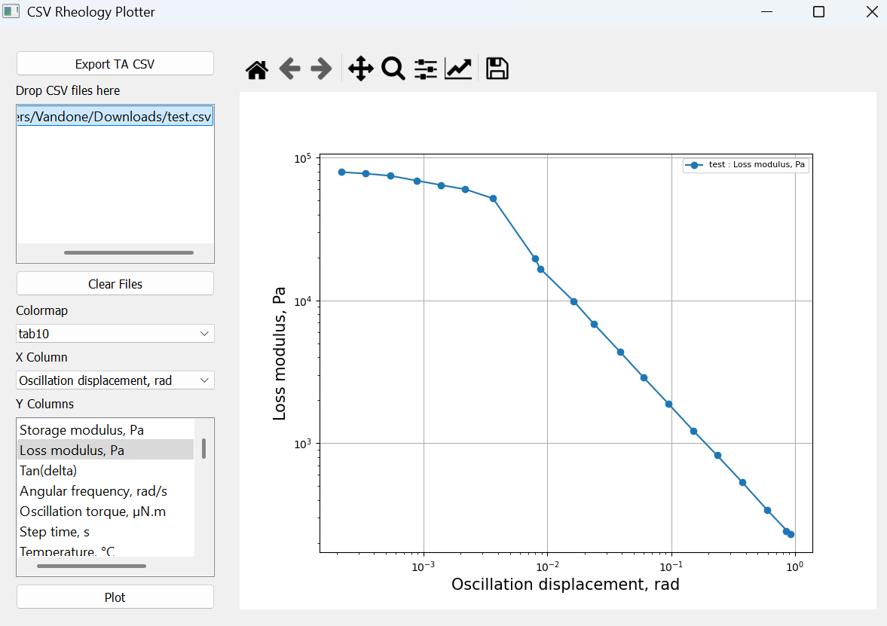

# Rheology CSV Plotter

A desktop application built with PyQt5 and Matplotlib for quickly visualizing rheology measurement data stored in CSV files.

The application supports drag-and-drop loading of multiple datasets, interactive file selection, customizable colormaps, and log-log plotting of selected variables.

At the moment is highly specific for csv files exported from TAInstruments software for DHR2 Hybrid rheometer thus some steps in the csv loading might fall into errors if different filetypes are employed
## Features

- Drag-and-drop CSV file import
- Multi-file dataset comparison
- Interactive file selection
- Automatic detection of numeric columns
- Select X and multiple Y variables
- Log-log plotting
- Customizable Matplotlib colormaps
- Automatic dataset labeling from filenames
- Embedded Matplotlib canvas
- Support for rheology datasets with multi-row headers

## Screenshot



## Installation

### Clone the repository

```bash
git clone https://github.com/yourusername/rheology-csv-plotter.git
cd rheology-csv-plotter
```

### Create a virtual environment (optional)

```bash
python -m venv venv
```

Activate it:

Linux/macOS:

```bash
source venv/bin/activate
```

Windows:

```bash
venv\Scripts\activate
```

### Install dependencies

```bash
pip install -r requirements.txt
```

## Requirements

- Python 3.9+
- PyQt5
- pandas
- matplotlib
- numpy

Install manually:

```bash
pip install pyqt5 pandas matplotlib numpy
```

## CSV Format

The application is designed for rheology exports where:

- Row 1 contains parameter names
- Row 2 contains units
- Data begins from row 3

Example:

|   | Frequency | Frequency | G' | G' |
|---|-----------|-----------|----|----|
|   | Hz | Hz | Pa | Pa |
| 0 | 0.1 | ... | 100 | ... |
| 1 | 1.0 | ... | 250 | ... |

The first two rows are combined into column names:

The "Export TA csv" button at the top takes in input xslx files generated from TA instrument software and splits all the sheets into separate files, discarding the "Details" sheet.


```
Frequency, Hz
G', Pa
```

## Usage

### Loading data

1. Launch the application.
2. Drag one or more CSV files into the file panel.
3. Dropped files are automatically loaded and selected.

### Selecting variables

1. Choose an X-axis column.
2. Select one or more Y-axis columns.
3. Select the datasets you want to compare.

### Plotting

Click **Plot** to generate the graph.

The plot uses logarithmic scales on both axes:

```python
ax.loglog(...)
```

## Project Structure

```
.
├── main.py
├── README.md
├── requirements.txt
└── example_data/
```

## License

MIT License